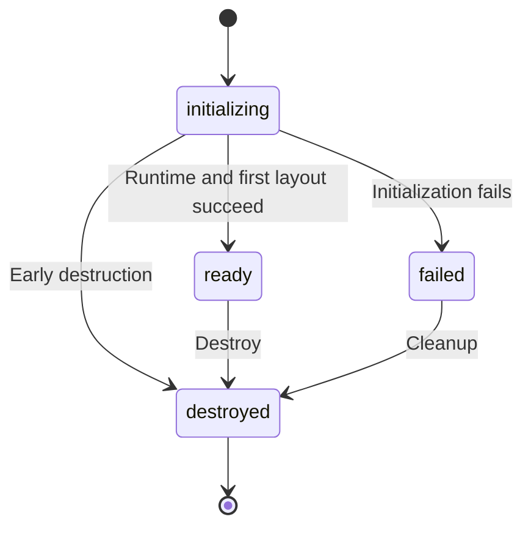

# Editor lifecycle and font APIs

Import public runtime values and types from `@herberthe/canvas-editor`. Internal Draw objects, caches and hosts are not stable public APIs. Use `editor.command` for document operations and `editor.register` for registration.

## Creation and lifecycle

```typescript
import Editor from '@herberthe/canvas-editor'

const editor = await Editor.create(container, {
  main: [{ value: 'Weekend plans' }]
})
console.log(editor.version, editor.state)
// On unmount: editor.destroy()
```

| Member                                     | Contract                                                                        |
| ------------------------------------------ | ------------------------------------------------------------------------------- |
| `Editor.create(container, data, options?)` | Return a ready editor asynchronously; clean up on initialization failure        |
| `new Editor(container, data, options?)`    | Construct synchronously; await `.ready` afterward                               |
| `ready: Promise<void>`                     | WASM, explicit fonts and first layout, not background fonts/all offscreen pages |
| `state`                                    | `initializing` / `ready` / `failed` / `destroyed`                               |
| `initializationError`                      | Initialization failure with code/cause, not coverage diagnostics                |
| `version`                                  | Package version                                                                 |
| `destroy()`                                | Release editor resources; the application owns external tools/listeners         |



Create cleans up failed instances; catch its rejection. With synchronous construction, handle ready rejection and destroy the instance yourself. Missing glyphs do not reject ready. Most non-ready mutation/geometry commands fail rather than queue; see [migration](./font-and-esm-migration.md) for exceptions.

## Fonts and diagnostics

| API                                         | Purpose                                                             |
| ------------------------------------------- | ------------------------------------------------------------------- |
| `register.fonts(faces)`                     | Wait for ready; return per-face registered/duplicate/failed results |
| `register.getFontFaces()`                   | Snapshot of registered font metadata                                |
| `register.getFontRevision()`                | Font revision used for layout invalidation                          |
| `getFontCoverageReport()`                   | Current missing text, sources, styles and download states           |
| `retryFontDownloads()`                      | Retry current missing fonts after ready; respect the toggle         |
| `listener.fontCoverageChange`               | Single callback slot                                                |
| `eventBus.on/off('fontCoverageChange', cb)` | Multiple subscribers                                                |

```typescript
import type { FontCoverageReport } from '@herberthe/canvas-editor'

const onCoverage = (report: FontCoverageReport) => {
  for (const issue of report.issues) {
    console.log(issue.script, issue.reason, issue.downloadStatus)
  }
}
editor.eventBus.on('fontCoverageChange', onCoverage)
onCoverage(editor.getFontCoverageReport())
// Cleanup uses the same callback:
editor.eventBus.off('fontCoverageChange', onCoverage)
```

`on()` does not return an unsubscribe function. Read a current snapshot after subscribing to avoid relying on the first event's timing. Reports can contain document characters and locations; applications control logging/sharing. Basic font downloads do not guarantee complete coverage.

Root-exported types include `IEditorOption`, `IUpdateOption`, `IEditorFontFace`, `FontCoverageReport`, `FontRegistrationResult`, `RegisteredFontFace`, `EditorRuntimeState` and `EditorRuntimeErrorCode`, plus runtime class `EditorRuntimeError`. See [fonts and ESM migration](./font-and-esm-migration.md) for errors, offline use and registration examples.

## Related APIs

- [Mutation commands](./command-execute.md): content, range, style, pages and modes.
- [Queries and export](./command-get.md): values, images, HTML and geometry.
- [Listener](./listener.md) / [EventBus](./eventbus.md): callback and subscription interfaces.
- [Quick start](./start.md): creation, persistence, printing and cleanup.
