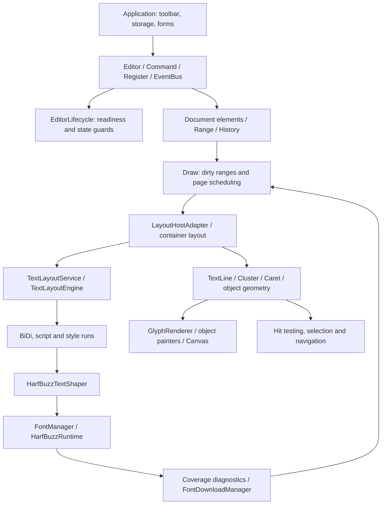

# Architecture and responsibilities

This page describes the current 0.1.0 implementation of `@herberthe/canvas-editor`: HarfBuzz shapes all text and Canvas paints document pages. There is no legacy text fallback, UMD build or selectable SVG page backend. See the [rendering pipeline](./rendering-pipeline.md) for execution details.

## Layers

Arrows show responsibilities and data dependencies, not worker boundaries. HarfBuzz layout currently runs on the main thread. Existing workers support tasks such as word counting and serialization; they are not text layout workers.

## Source map

Paths are relative to the repository root. These are internal modules, not supported npm deep imports.

| Module           | Location                                                     | Responsibility                                                          |
| ---------------- | ------------------------------------------------------------ | ----------------------------------------------------------------------- |
| Public entry     | `src/editor/index.ts`                                        | Normalize data, assemble modules, create/ready, destruction and exports |
| Lifecycle        | `src/editor/core/EditorLifecycle.ts`                         | Initializing, ready, failed and destroyed states; command guards        |
| Commands         | `src/editor/core/command/`                                   | Public mutation/query entry points and selection operations             |
| Scheduling       | `src/editor/core/draw/Draw.ts`                               | Dirty ranges, container flow, pagination, positions and painting        |
| Layout hosts     | `src/editor/core/text-engine-host/`                          | Paragraph bridge, tables, objects, document flow and page chrome        |
| Typography       | `src/editor/core/text-engine/`                               | Font binaries, BiDi, HarfBuzz, line breaking, outlines and diagnostics  |
| Geometry         | `src/editor/core/layout/`, `src/editor/interface/Layout.ts`  | Shared line, glyph, cluster, caret and object geometry                  |
| Interaction      | `src/editor/core/position/`, `core/range/`, `core/listener/` | Input events, hit testing, selection, carets and keyboard behavior      |
| Model/extensions | `src/editor/interface/`, `src/plugins/`                      | Public types, document model and plugin integration                     |

## Three distinct data layers

1. **Persisted document**: header/main/footer, element styles, tables and controls in `IEditorData`. Use `command.getValue()` to save business content, rather than persisting internal coordinates or font objects.
2. **Runtime elements**: normalized and split elements with logical source references, used by editing, history and the layout bridge. A runtime array index is not necessarily a UTF-16 character index: graphemes, surrogate pairs, controls and paragraph markers affect the mapping.
3. **Layout geometry**: TextLine, glyphs, clusters, carets, inline objects and page positions. Results depend on the current font revision and constraints and must be recomputed when these change.

Internal `LayoutRow` views still support container flow and host integration. Keeping “row” in a name does not imply that the old text measurement loop remains. Public row snapshots are detached compatibility DTOs, not inputs to the next layout pass.

## Typography, containers and paint

HarfBuzz supplies contextual glyph IDs, clusters, advances and offsets. It does not paginate an editor document or split tables. TextLayoutEngine combines bidirectional analysis, font selection and line breaking; TextLayoutService converts font metrics and ink bounds into baselines, line boxes, clusters and carets.

Container hosts handle columns, available widths, floating-image constraints, table cells and page fragments. Document flow combines header, body and footer. GlyphRenderer paints outlines from real font data; images, formulas, controls and blocks retain dedicated object painters. DOM input proxies, tool overlays and accessibility messages remain part of the application: Canvas-only describes the document page renderer.

## Lifecycle, events and history

Initialization failures reject ready. Missing glyphs instead keep editable placeholders and produce coverage diagnostics. Registering downloaded fonts changes the font revision, invalidates layout and schedules a new render; it does not simply replace a few painted characters.

Commands apply business operations. History captures document/selection state for undo and redo; it is not a CRDT or collaborative operation log. Listener exposes single callback slots, while EventBus supports multiple subscribers. The host must release its own subscriptions, toolbar and external resources on unmount.

## Extension and performance boundaries

Integrate through public root exports. Plugins that depend on internal Draw objects, old row coordinates or browser text measurement require adaptation. Upstream package compatibility must be verified individually; see [migration](./font-and-esm-migration.md).

`lab.incrementalCompute` defaults to false. It reuses unchanged native paragraph layouts, while document flow, pagination and positions still run. Long dirty paragraphs, cache cloning and global flow can make it slower. The [final acceptance record](../../guide/native-release-acceptance.md) contains T23/T24 measurements; performance targets and future SVG designs are not shipped capabilities.
