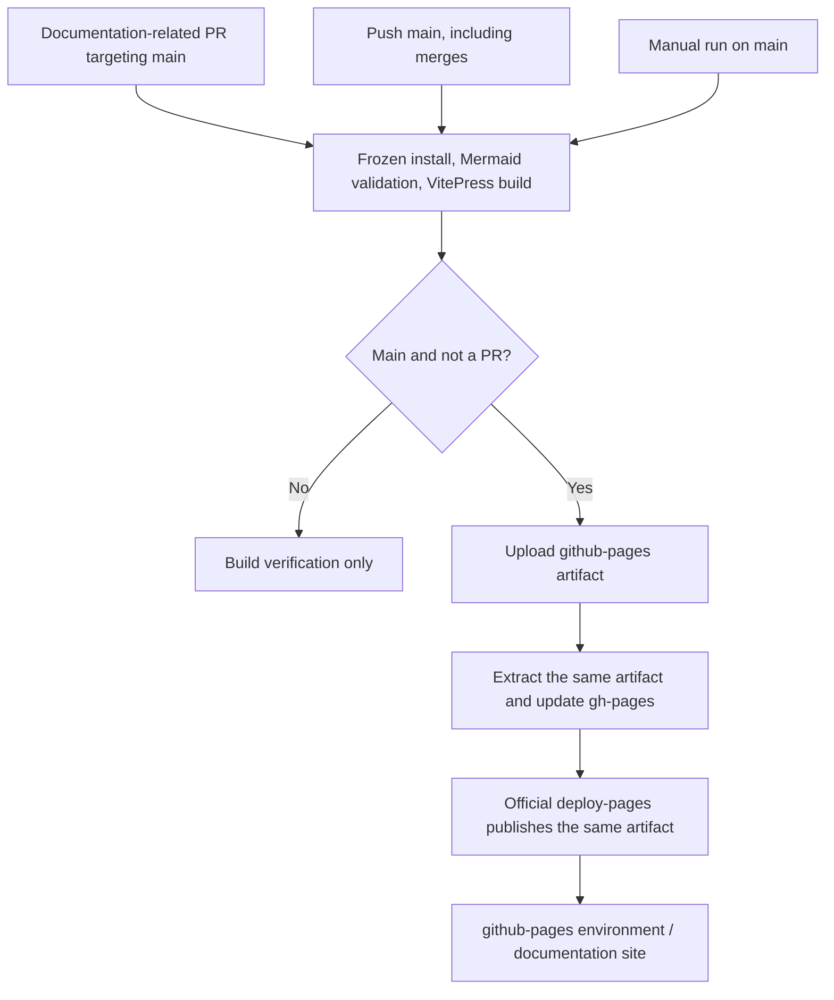

# Deploy documentation to GitHub Pages

VitePress sources live in `docs/`. Merging into `main` triggers `.github/workflows/docs.yml`, builds the documentation and online editor demo, updates `gh-pages`, and deploys the same artifact through official Pages Actions. The workflow still needs repository Pages configuration and a successful remote run before the site is available.

## One-time setup

1. Open **Settings → Pages → Build and deployment**.
2. Set **Source** to **GitHub Actions**.
3. Enable Actions and allow the workflow's `GITHUB_TOKEN` to write `gh-pages`. The `github-pages` environment must allow deployments from `main`; organization policies and branch rules can restrict access.
4. Merge into `main`, or manually run **Documentation Pages** against `main`.
5. Open the deploy job's environment URL. With the current repository name, the expected project URL is `https://herberthe.github.io/canvas-editor/`; this is not a claim that it is already live.

Do not select **Deploy from a branch** for this workflow. GitHub does not trigger branch-based Pages builds from commits pushed with `GITHUB_TOKEN`. Here `gh-pages` preserves inspectable static output, while `deploy-pages` publishes the artifact directly. See [GitHub's publishing-source documentation](https://docs.github.com/en/pages/getting-started-with-github-pages/configuring-a-publishing-source-for-your-github-pages-site).

No SSH server credentials, HOST, USERNAME, PASSWORD, DOCS_PATH or PAT are needed. `configure-pages` checks an existing configuration; it does not automatically enable the site with the default token. Configure Pages first and rerun if that check fails.

## Trigger and artifact flow



| Job              | Purpose                                                                   | Write access                |
| ---------------- | ------------------------------------------------------------------------- | --------------------------- |
| `build`          | Node 24, pnpm 10.32.1, frozen install, diagrams and VitePress build       | None; contents read only    |
| `publish-branch` | Download artifact.tar and synchronize the extracted site root to gh-pages | contents write              |
| `deploy`         | Check Pages configuration and deploy the same artifact                    | pages write, id-token write |

Relevant PRs only validate. Every main push rebuilds, including source changes without Markdown changes. Manual runs on other branches build without publishing. Runs for the same ref are serialized; deployment uses the `github-pages` environment.

The output contains root `index.html`, `guide/`, `en/`, `assets/` and `.nojekyll`. Do not edit generated branch files directly. Change documentation sources in a development branch and merge into main. `clean: true` removes obsolete generated pages; the workflow does not force-push over branch history.

## Local validation and base URL

```sh
pnpm install --frozen-lockfile
pnpm run docs:check
pnpm run docs:build
pnpm run docs:preview
```

Default base is `/canvas-editor/`; open that path on the preview server. Output is `docs/.vitepress/dist`, including the standalone editor and its workers, WASM, fonts and assets under `playground/`. The home page, navigation and [playground guide](./playground.md) link to it. `docs:build` includes Mermaid syntax validation, so malformed diagrams fail CI. Chinese and English entry points are `/canvas-editor/` and `/canvas-editor/en/`. Search uses a local build-time index without Algolia credentials. Diagrams load on the client, follow the current theme and expose their source.

## Repository rename and custom domains

VitePress reads `DOCS_BASE`, defaulting to `/canvas-editor/`. If the repository is renamed, update the workflow's build environment to `/<new-repository>/` and validate locally with the same value.

For a custom domain or user root site, the base is usually `/`. Configure GitHub Pages DNS and Custom domain separately. If a CNAME file is needed, add the real domain to `docs/public/CNAME`; editing only the generated branch would lose it during clean publication. No domain or DNS configuration is performed by this change.

## Demo CI and troubleshooting

`.github/workflows/build.yml` runs application lint, type checking, tests and demo build, then uploads `canvas-editor-demo`. The docs workflow separately builds the same demo into the site's `playground/` subdirectory without overwriting the documentation homepage or deploying to the upstream maintainer's server.

Both `docs:dev` and `docs:build` first run `scripts/build-docs-demo.mjs`, using DOCS_BASE for demo asset URLs. Generated output in `docs/public/playground/` is ignored by Git and copied into the final site by VitePress. Do not commit it. The demo inside the docs development server is a static build; restart `docs:dev` after editing editor sources.

| Symptom                       | Check                                                         |
| ----------------------------- | ------------------------------------------------------------- |
| configure-pages fails         | Set Pages Source to GitHub Actions, then rerun                |
| gh-pages write returns 403    | Actions policy, contents permission and gh-pages branch rules |
| Environment blocks deployment | github-pages allowed branches or required reviewers           |
| Assets/subpages return 404    | DOCS_BASE, repository name, full artifact and URL prefix      |
| Workflow is missing           | File merged into main and Actions enabled                     |
| PR has no deployment URL      | Expected: deployment starts after merging into main           |

Local validation cannot prove remote deployment success. Inspect all three jobs and the environment URL in the actual GitHub run.
