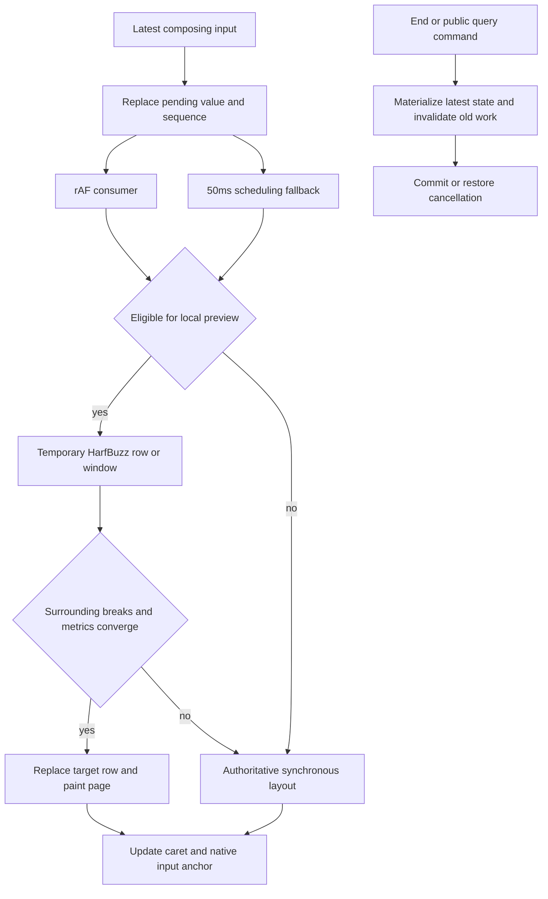

# Performance optimization principles

This page explains how the current implementation reduces repeated work during
typing, sustained deletion and Chinese composition. See [Benchmark](benchmark.md)
for measurements and [experimental configuration](lab.md) for switches and limits.
Baseline remains the default. Both `imePreview` and `imeWorkerPreview` default to
false; selecting sync/worker does not enable them. Release acceptance remains hold.

## Where input latency comes from

An edit can trigger paragraph scanning, HarfBuzz shaping, line breaking, pagination,
position/query-index commits, font coverage, painting, caret placement and tools.
Repeating the full pipeline for every pinyin intermediate state scales with the
document. Moving work to a Worker reduces main-thread occupancy but retains the
computation, transport and queueing costs.

Measure handler time and update-to-geometry latency separately. A short handler
can simply mean that expensive work was deferred.

| Technique | Work avoided | Remaining cost |
| --- | --- | --- |
| Paragraph caches and incremental flow | Unchanged shaping, breaking and flow | Dependency checks and affected pagination |
| Range position/query commits | Rebuilding unchanged character positions/indexes | Global metadata and line/paragraph directories |
| Latest composition state per frame | Computing states superseded in the same frame | Frame wait and final commit |
| Local preview/window | Full-document/full-paragraph layout | Convergence checks, page paint and fallbacks |
| Deferred derived work | Repeated full coverage/highlight/tool refresh | Query/export/finalization barriers |
| Cell layout cache | Unchanged text-cell child layout | Table checks, changed cells and grid propagation |
| Worker and queue control | Migratable main-thread layout and redundant queueing | DTOs, transfer, waiting and main-thread commit |

## Reuse paragraphs, flow and positions separately

Paragraph shaping/breaking can be reused when both content and layout dependencies
match. Font revision, width and relevant style changes invalidate the result.
Glyph-path and shaping-run caches reduce repeated outline construction/shaping;
they do not remove required line-breaking or pagination validation.

`IncrementalFlow` retains input/output checkpoints. After an edit, it recomputes the
affected range and reuses the suffix only when flow state, dependencies and page
constraints converge exactly. Height, floats or width changes may propagate further.
Batch suffix reuse still validates paragraph metadata and distinct page checkpoints.

Position commits reuse line/position blocks. Source-offset views represent logical
index shifts after an insertion without copying all later characters or rebuilding
unchanged query character tables. Readers see current indices/coordinates while old
references remain valid. Global directories still require work: this is not O(1).

Implementation: `IncrementalFlow.ts`, `relativeLayout.ts`, `Position.ts` and
`PositionList.ts` under `src/editor/core/layout/` and `core/position/`.

## Composition previews before formal commits

`CompositionSession` retains the latest value and sequence. `input` is authoritative;
`compositionupdate` does not independently edit the model. If `n` is superseded by
`ni` before the frame consumes it, `n` is counted as merged, not displayed.

The frame and timer consume the same pending state; the first cancels the other.
50ms is a scheduling fallback, not a debounce or a latency guarantee while blocked.
For cheap edits, waiting for a frame can increase geometry latency.

The temporary preview still uses HarfBuzz glyphs, line breaking and carets. It does
not estimate width from character counts or use browser text APIs. A successful
preview keeps the formal model, substitutes the target row and paints the composition
underline. The whole containing page is painted; this is not Tile rendering.

Long-paragraph windows contain the target and available neighboring rows, limited
to 2048 elements and safe complete wrap-unit boundaries. Surrounding source ranges,
glyphs, carets, heights and baselines must converge. Changed wrapping/dependencies
cause fallback. The window currently supports eligible Latin/Han/Common/Inherited
text with uniform metric styles, not arbitrary BiDi/contextual scripts or containers.

Final selection becomes a formal transaction; cancellation restores content/range.
Intermediate previews are not separate undo records. Public content/geometry queries
materialize the current composition and derived state; public mutations finish the
session. These barriers can incur full layout and must remain part of correctness.

Implementation: `CompositionSession.ts`, `CanvasEvent.ts`, `CompositionPreview.ts`.

## Defer derived work and share anchor geometry

Full font coverage, search/control highlights and tool geometry need not be published
for each pinyin state. Composition marks them dirty, scans only required local font
coverage and retains missing-font downloads. Finalization/query/export restores the
complete authoritative state through `flushCompositionDerivedState()`. Changed font
or auxiliary-content dependencies can still force full scans. Deferred work remains
a finalization cost rather than disappearing.

`CompositionAnchor` shares the latest caret with the native textarea. It reads the
container, scroll ancestors and visual viewport before writing styles/scroll, and
coalesces placement in a microtask within the current frame. It preserves textarea
value/selection owned by native composition. Scrolling/resizing repositions the
anchor without immediately undoing manual scrolling. DOM coordinates do not prove
that a real OS candidate window follows correctly.

## Cell caching and protected admission

Text-cell reuse checks content, element identities and layout dependencies. Hits
project current revisions instead of repeating child layout. Unchanged table structure
and cell heights permit grid reuse. Height changes still propagate row constraints
and pagination; unsupported nested/stateful content follows ordinary recursion.

The cache allows 512 entries and an internally estimated 16 MiB. A plain LRU scanning
600 cells can repeatedly evict the next pass's useful entries. Admission now protects
entries used in the current/previous pass, accepts a candidate only if it fits fully,
and otherwise skips it without partial eviction. Eviction candidates are built once
per pass; old documents become reclaimable after a full idle pass.

A stable 600-cell scan can therefore reuse 512 and compute 88. It still checks the
whole table. `computedCells` counts child layout, not HarfBuzz cache misses; estimated
`bytes` is not actual process/WASM/GPU memory. Implementation: `TableLayoutCache.ts`.

## Worker freshness and recovery

Ordinary Worker editing maintains an ordered model mirror. Sustained deletion keeps
synchronous geometry commits while coalescing paint. Bounded transaction/byte queues
and ordered acknowledgments prevent unbounded accumulation. Faults or budget excess
rebuild the mirror from the current authoritative model without losing confirmed edits.

IME Worker preview is separate and experimental: temporary body-paragraph layout moves
to the Worker; input, validation, formal commits, painting and anchors remain on the
main thread. It does not add asynchronous table layout. Replies must match session,
sequence, document/geometry/font/constraint revisions. Stale replies are discarded.
Failure/50ms fallback uses synchronous layout; ending/cancelling/destroying invalidates
old replies without implying that in-flight computation has stopped.

End-to-end cost includes DTO preparation, messaging, queueing, computation, return,
validation and paint. Reduced handler time with worse geometry is not a refresh win.
`imeWorkerPreview` stays false and profiles do not automatically enable transfer.

## WebGL/WebGPU and current scope

These optimizations do not implement WebGL/WebGPU layout or GPU Tile rendering.
HarfBuzz/WASM, flow, indexes, history and dependency checks remain on existing CPU/
Worker paths, with Canvas path drawing. Browser Canvas acceleration is not a project
GPU layout implementation. Benefits here come from avoiding work, reducing scope and
scheduling. A future GPU path would need separate resource/precision/pixel/transport
validation and fresh geometry, presentation and memory measurements.

## Reading and reproducing the evidence

See [latest automated results](benchmark.md#final-automated-results). The five-scene
baseline→sync comparison combines multiple changes; it cannot attribute all benefits
to one switch. The large-table toggle and historical IME-10/11/12/13 studies isolate
their own scope. Older dated measurements retain their original source/methodology.
The current long fixture edits near the paragraph beginning, unlike IME-11's
final-row window cases; those gains do not establish arbitrary-position reuse.

- Handler: event-function duration, possibly reduced by deferring work.
- Geometry: update-to-consumption proxy including scheduling, not screen presentation.
- Next rAF: update-to-next-callback after consumption, not actual FPS.
- P50/P95/P99/max: sorted percentiles and maximum; per-trial ranges differ from pooled distributions.
- Counters: distinguish received, merged, consumption submissions and pending updates handled at end;
  finalized is not the number of final selections. Unsupported Long Tasks APIs are unavailable.
  Closure frame gaps include commit/history work and cannot establish preedit FPS.

Start Vite and run `npm run test:performance:ime:release` with `BASE_URL`. Runtime
configuration and commands are in the [acceptance instructions](../../guide/ime-performance-tasks.md).
Quality/correctness run before serial timing; each mode is warmed up and order alternates
over three trials. JSON retains environment, timestamps, source/font/tool/configuration
fingerprints and distributions; raw text/screenshots are not committed.

Synthetic input cannot establish native macOS/Windows IME/candidate behavior, mobile
experience or long-term memory stability. Budgets remain handler P95 ≤8ms and geometry
P95 ≤32ms. Missing manual evidence or failed budgets keep hold.
