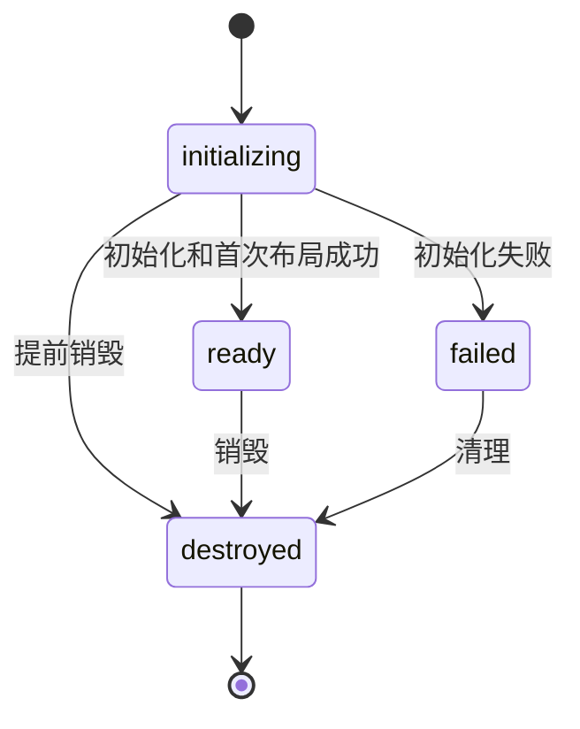

# 实例、生命周期与字体 API

所有公开运行时与类型均从 `@herberthe/canvas-editor` 包根导入。内部 Draw、排版缓存和宿主对象不属于稳定公开接口。修改/查询内容通过 `editor.command`，注册扩展通过 `editor.register`。

## 创建与生命周期

```typescript
import Editor from '@herberthe/canvas-editor'

const editor = await Editor.create(container, { main: [{ value: '周末计划' }] })
console.log(editor.version, editor.state) // 当前版本与 ready 状态
// 卸载时：editor.destroy()
```

| 成员                                       | 语义                                                       |
| ------------------------------------------ | ---------------------------------------------------------- |
| `Editor.create(container, data, options?)` | 异步返回就绪实例；初始化失败清理实例并拒绝                 |
| `new Editor(container, data, options?)`    | 同步构造，随后必须等待 `.ready`                            |
| `ready: Promise<void>`                     | 等待 WASM、显式字体、首次布局；不等待后台补字体/全部屏外页 |
| `state`                                    | `initializing` / `ready` / `failed` / `destroyed`          |
| `initializationError`                      | 初始化失败原因，带 code/cause；不是缺字报告                |
| `version`                                  | 包版本                                                     |
| `destroy()`                                | 销毁编辑器及其内部资源；外部工具栏、变量和订阅由宿主负责   |

生命周期状态图：



create 遇到失败会清理，因此调用方通常直接捕获 create 的拒绝。同步构造需捕获 ready 拒绝并自行销毁。缺字不会使 ready 失败。非就绪期间多数修改/几何命令直接拒绝，不自动排队，具体例外见[迁移指南](./font-and-esm-migration.md)。

## 字体与诊断

| API                                         | 作用                                                                     |
| ------------------------------------------- | ------------------------------------------------------------------------ |
| `register.fonts(faces)`                     | 等待 ready，异步注册字体；逐项返回 `registered` / `duplicate` / `failed` |
| `register.getFontFaces()`                   | 已注册字体元数据快照                                                     |
| `register.getFontRevision()`                | 字体版本；新增有效字体后触发布局失效                                     |
| `getFontCoverageReport()`                   | 当前缺字快照，含字符/序列、来源、样式与下载状态                          |
| `retryFontDownloads()`                      | ready 后重试当前缺字；尊重自动下载开关                                   |
| `listener.fontCoverageChange`               | 单个字体诊断回调槽                                                       |
| `eventBus.on/off('fontCoverageChange', cb)` | 多订阅者诊断事件                                                         |

```typescript
import type { FontCoverageReport } from '@herberthe/canvas-editor'

const onCoverage = (report: FontCoverageReport) => {
  for (const issue of report.issues) {
    console.log(issue.script, issue.reason, issue.downloadStatus)
  }
}
editor.eventBus.on('fontCoverageChange', onCoverage)
onCoverage(editor.getFontCoverageReport())
// 清理时使用同一函数：
editor.eventBus.off('fontCoverageChange', onCoverage)
```

`on()` 不返回取消订阅函数。订阅之后读取一次当前快照，可避免错过初始化期间的更新。报告可能含文档字符与来源位置，宿主应决定是否记录或发送。基本字体下载不是所有字符已覆盖的保证。

公开类型包含 `IEditorOption`、`IUpdateOption`、`IEditorFontFace`、`FontCoverageReport`、`FontRegistrationResult`、`RegisteredFontFace`、`EditorRuntimeState`、`EditorRuntimeErrorCode`，运行时类 `EditorRuntimeError` 也从包根导出。错误、离线和运行期字体示例见[字体与 ESM 迁移](./font-and-esm-migration.md)。

## 业务操作入口

- [执行命令](./command-execute.md)：内容、选区、样式、页面和模式修改。
- [查询与导出](./command-get.md)：getValue、getImage、HTML、目录与位置查询。
- [Listener](./listener.md) / [EventBus](./eventbus.md)：单回调与多订阅事件。
- [快速上手](./start.md)：完整创建、保存、打印与清理示例。
