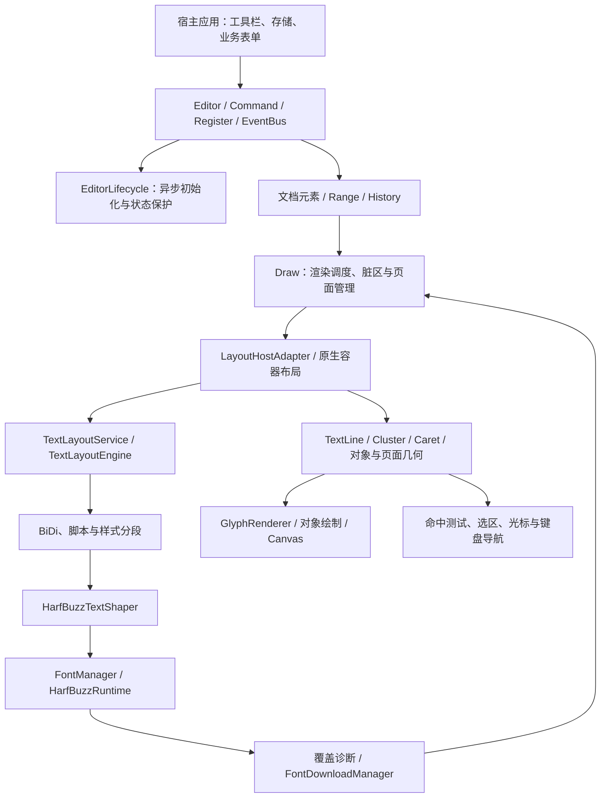

# 架构与模块职责

本页描述 `@herberthe/canvas-editor` 0.1.0 的当前实现。文字由 HarfBuzz 统一整形，页面由 Canvas 绘制；不存在 legacy 文字排版回退、UMD 包或可切换的 SVG 页面后端。完整执行过程见[渲染管线与时序](./rendering-pipeline.md)。

## 分层视图

图中箭头表示职责与数据依赖，不代表每个模块都在独立线程运行。默认 HarfBuzz 排版在主线程执行；`worker` 实验配置可将受支持简单正文的文本内核放入布局 Worker，复杂范围与几何消费者仍同步刷新。统计、目录与序列化有独立辅助 Worker。线程与回退条件见[实验配置](lab.md)。

## 模块索引

以下路径相对于仓库根目录，属于内部实现，不能作为 npm 深路径导入。

| 模块         | 主要位置                                                     | 职责                                               |
| ------------ | ------------------------------------------------------------ | -------------------------------------------------- |
| 公开入口     | `src/editor/index.ts`                                        | 数据标准化、模块组装、create/ready、销毁、公开导出 |
| 生命周期     | `src/editor/core/EditorLifecycle.ts`                         | 初始化/就绪/失败/销毁状态，命令时机保护            |
| 命令         | `src/editor/core/command/`                                   | 对外操作入口、选区修改、格式与文档命令             |
| 渲染调度     | `src/editor/core/draw/Draw.ts`                               | 消费脏区、容器布局、分页、位置、页面与绘制调度     |
| 原生布局宿主 | `src/editor/core/text-engine-host/`                          | 段落桥接、表格、对象、页眉页脚与文档流             |
| 文字整形     | `src/editor/core/text-engine/`                               | 字体字节、BiDi、HarfBuzz、断行、字形轮廓与诊断     |
| 原生几何协议 | `src/editor/core/layout/`、`src/editor/interface/Layout.ts`  | 行、glyph、cluster、caret、容器和对象的统一几何    |
| 交互         | `src/editor/core/position/`、`core/range/`、`core/listener/` | 输入事件、命中、选区、光标和键盘行为               |
| 数据与扩展   | `src/editor/interface/`、`src/plugins/`                      | 公开类型、文档模型与插件接入                       |

## 三类数据不能混用

1. **持久化文档**：`IEditorData` 中的 header/main/footer 与元素样式、表格和控件信息。保存业务内容时使用 `command.getValue()` 的结果，不保存内部坐标和字体对象。
2. **运行期元素**：标准化、拆分后的元素与逻辑来源，用于编辑、历史和布局桥接。不能把运行期数组下标等同于 UTF-16 字符下标；组合文字、代理对、控件与段落标记会影响映射。
3. **布局几何**：TextLine、glyph、cluster、caret、内联对象及分页位置。几何来源于当前字体版本、宽度与排版结果，字体或约束变化后必须重新计算。

内部 `LayoutRow` 仍承担容器流与宿主兼容职责；名称中保留 row 不代表旧文字测量循环仍在运行。公开查询返回的行快照是脱离内部对象的兼容 DTO，不是下一轮布局输入。

## 文字、容器与绘制的分工

HarfBuzz 负责上下文整形，给出 glyph ID、cluster、advance 和 offset；它不负责整篇编辑器的分页、表格拆页或工具栏。TextLayoutEngine 结合双向分析、字体选择与断行规则生成行；TextLayoutService 将字体度量与墨迹边界转成基线、行框、cluster 和 caret。

段落布局之外，容器宿主处理页宽、分栏、浮动图环绕、表格单元格和跨页分片，文档流组合页眉、正文与页脚。GlyphRenderer 使用真实字体的字形轮廓绘制文字；图片、公式、控件外观和块对象仍有专用绘制逻辑。DOM 继续承载输入代理、工具浮层和无障碍提示，因此 Canvas-only 指的是文档页面绘制方式，不代表整个应用没有 DOM。

## 状态、事件与历史

`EditorLifecycle` 将初始化失败与缺字分开：前者使 ready 拒绝，后者保留可编辑的缺字占位并输出诊断。字体下载完成会改变字体版本，触发布局失效和重新绘制，不是直接替换 Canvas 上的几个字符。

Command 负责业务操作，History 保存文档与选区等状态以支持撤销重做。它不是 CRDT 或协同操作日志。Listener 是单回调槽，EventBus 支持多个订阅者；宿主销毁时需清理自己的订阅、工具栏和外部资源。

## 扩展与性能边界

应用通过包根公开 API 集成。插件如需操作内部 Draw、旧行坐标或浏览器字体测量，必须重新适配；上游插件不能仅因包名相近就认为兼容。字体与 ESM 迁移见[迁移指南](./font-and-esm-migration.md)。

`lab.incrementalCompute` 是默认关闭的段落缓存，和 `performanceProfile` 分开控制。`sync` 配置增加事务追踪、flow 收敛、前缀页和未变行位置/查询复用、脏页及绘制合并。简单正文查询按 canonical 行身份缓存，source 索引平移不重建字符表；复杂范围保守完整计算。全局元数据仍需遍历，单个长段落仍有整段上下文整形成本。

Worker 镜像按顺序批量提交编辑，同时最多一个编辑批次在途，缓冲上限 128 条事务及 4 MiB；超限或故障后从当前权威文档恢复。恢复在连续编辑空闲后调度，显式排空也会触发；旧会话结果不能覆盖当前布局。Backspace/Delete 同步提交增量几何并合并绘制，输入可异步排版。缓存、定时器、请求和观察器在销毁时释放。配置与诊断见[实验特性](lab.md)，收益、尾延迟和未达预算项见 [Benchmark](benchmark.md)。
