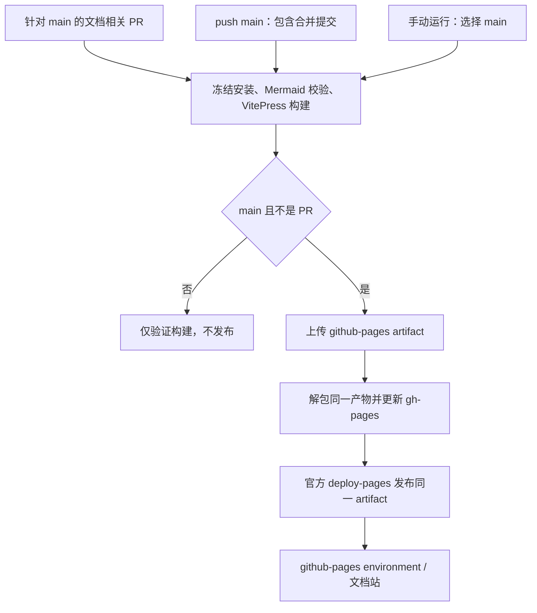

# GitHub Pages 文档部署

文档使用 VitePress，源文件在 `docs/`。合并 PR 到 `main` 会触发 `.github/workflows/docs.yml`，构建静态站和在线编辑器 Demo、更新 `gh-pages` 分支，并通过 GitHub 官方 Pages Actions 部署同一份产物。工作流代码已配置；站点实际可用需要仓库所有者完成下面的 Pages 设置并成功运行工作流。

## 仓库只需配置一次

1. 打开仓库 **Settings → Pages → Build and deployment**。
2. 将 **Source** 设为 **GitHub Actions**。
3. 检查 Actions 已启用，仓库规则允许工作流以 `GITHUB_TOKEN` 写入 `gh-pages`，`github-pages` environment 允许 `main` 部署。组织策略或分支保护可能限制这些权限。
4. 合并到 `main`，或在 Actions 的 **Documentation Pages** 页面选择 `main` 手动运行。
5. 在 deploy job 的 environment 链接查看实际地址。本仓库名保持 `canvas-editor` 时，预期项目站地址为 `https://herberthe.github.io/canvas-editor/`；这不是已经发布成功的声明。

**不要选择 Deploy from a branch。** GitHub 说明：由 `GITHUB_TOKEN` 推送的提交不会触发分支式 Pages 构建。因此这里将 `gh-pages` 作为可检查的静态产物分支，同时由 `deploy-pages` 正式发布，避免依赖分支推送再次触发构建。参见 [GitHub Pages 发布源说明](https://docs.github.com/en/pages/getting-started-with-github-pages/configuring-a-publishing-source-for-your-github-pages-site)。

不需要旧工作流的 SSH 服务器、HOST、USERNAME、PASSWORD 或 DOCS_PATH，也不需要为此添加 PAT。workflow 中 `configure-pages` 检查已有配置，不会用默认 token 擅自启用站点；未设置 Pages 时先配置，然后重跑失败的工作流。

## 事件与产物流向



| job              | 行为                                                                | 写权限                            |
| ---------------- | ------------------------------------------------------------------- | --------------------------------- |
| `build`          | Node 24、pnpm 10.32.1、冻结 lockfile 安装、检查图表、构建文档       | 无；`contents: read`              |
| `publish-branch` | 下载 Pages artifact，提取 artifact.tar，将站点根目录同步到 gh-pages | `contents: write`                 |
| `deploy`         | 检查 Pages 配置，将相同 artifact 发布到 Pages                       | `pages: write`、`id-token: write` |

文档相关 PR 只执行构建。所有 main push 都重新构建，使渲染行为变化即使未修改 Markdown 也能重新发布。手动在其他分支运行只构建，不发布。部署使用 `github-pages` environment，同一 ref 的工作流顺序执行，避免对 gh-pages 同时写入。

产物包含根 `index.html`、`guide/`、`en/`、`assets/` 和 `.nojekyll`。`gh-pages` 仅存生成内容，不应直接编辑；文档源修改应在开发分支提交，再合并 main。`clean: true` 会移除产物中已不存在的旧页面，工作流不会强推覆盖分支历史。

## 本地预览与路径

```sh
pnpm install --frozen-lockfile
pnpm run docs:check
pnpm run docs:build
pnpm run docs:preview
```

默认 base 为 `/canvas-editor/`，预览时访问终端地址下的 `/canvas-editor/`。构建输出是 `docs/.vitepress/dist`，其中 `playground/` 包含可独立运行的编辑器、Worker、WASM、字体和其他资源。文档首页、导航和[在线体验](./playground.md)均提供入口。`docs:build` 已包含 Mermaid 语法校验；错误图表会让 CI 失败，不会静默以代码块代替图形。

中文入口 `/canvas-editor/`，英文入口 `/canvas-editor/en/`。搜索是构建期生成的本地索引，不需要 Algolia 密钥。Mermaid 在客户端按需加载，支持明暗主题；展开图表下的源码可复制设计。

## 更换仓库名或自定义域名

VitePress 配置读取 `DOCS_BASE`，未设置时为 `/canvas-editor/`。如果仓库改名，修改 workflow 构建步骤的 `DOCS_BASE` 为 `/<新仓库名>/`；本地用同样的值验证。

使用独立域名或用户根站点时通常设为 `/`，同时按 GitHub Pages 配置 DNS 和 Custom domain。如需保留域名文件，在 `docs/public/CNAME` 写入真实域名；不要只向生成分支手工添加，因为下一次 clean 发布会覆盖它。本文没有配置任何实际域名或 DNS。

## Demo 工作流与故障排查

`.github/workflows/build.yml` 对应用执行 lint、类型检查、单测和 Demo 构建，上传独立的 `canvas-editor-demo` artifact。文档工作流另将同一 Demo 构建到文档站的 `playground/` 子目录，不覆盖文档首页，也不再部署到上游维护者的服务器。

`docs:dev` 和 `docs:build` 都会先执行 `scripts/build-docs-demo.mjs`，使用同一个 DOCS_BASE 计算 Demo 的资源前缀。临时输出在 `docs/public/playground/`，已加入 gitignore，由 VitePress 拷贝进入最终产物。该目录无需提交。文档开发服务器中的 Demo 是静态构建；修改编辑器源代码后需重新运行 `docs:dev`。

| 现象                                  | 检查                                                 |
| ------------------------------------- | ---------------------------------------------------- |
| Pages 尚未启用或 configure-pages 失败 | Settings → Pages 的 Source，启用后重跑               |
| gh-pages 更新 403 / 被规则拒绝        | Actions 策略、contents 写权限、gh-pages 保护与规则集 |
| deploy 被 environment 阻止            | github-pages 的允许分支或 required reviewers         |
| 首页正常，资源或子页 404              | DOCS_BASE、仓库名、完整 artifact 目录和 URL 前缀     |
| workflow 未出现                       | 文件是否已合并 main、Actions 是否启用                |
| PR 没有部署链接                       | 预期行为：PR 只构建，合并 main 后发布                |

工作流在 GitHub 上成功并不由本地构建替代；发布结果以对应 run 的三个 job 和 environment URL 为准。
