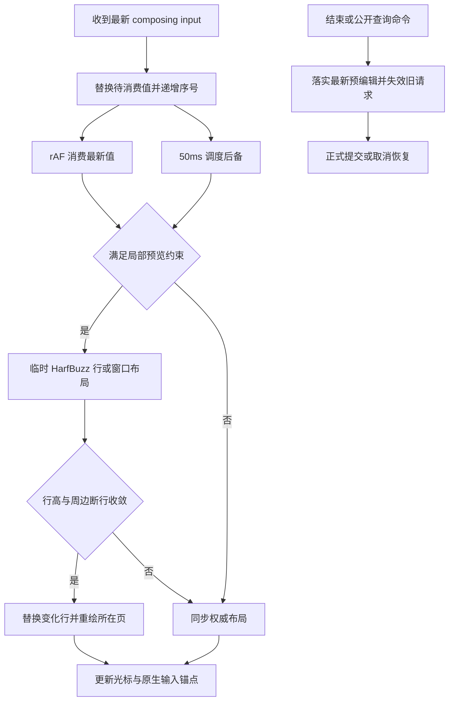

# 性能优化原理

本页解释当前实现如何减少输入、持续删除和中文预编辑的重复工作。
实测结果见 [Benchmark](benchmark.md)，开关和支持范围见[实验配置](lab.md)。
默认仍使用 baseline；`imePreview` 与 `imeWorkerPreview` 均默认关闭，
选择 sync/worker profile 不会自动开启它们。发布验收保持 hold。

## 输入为什么会卡顿

一次输入可能触发段落扫描、HarfBuzz 整形、断行、分页、位置与查询索引提交、
字体覆盖扫描、页面绘制、光标定位和工具层刷新。
如果每个拼音中间态都走完整流程，计算量会随着文档规模增长。
把任务移到 Worker 可以减少主线程占用，却不能消除计算量、消息传输和等待时间。

应同时观察两个问题：事件处理是否阻塞后续输入，以及最新文本多久获得有效几何。
它们分别对应 handler 和 geometry 代理指标，不能互相替代。

| 手段 | 减少的工作 | 仍然存在的成本 |
| --- | --- | --- |
| 段落缓存与增量 flow | 未变化段落的整形、断行和重复文档流计算 | 依赖验证、受影响的后续分页 |
| 范围位置与查询提交 | 未变化字符的位置对象、查询字符表重建 | 行/段落目录、全局元数据更新 |
| 合成状态按帧消费 | 同一帧内被后续状态替代的预编辑计算 | 等待下一帧、最终正式提交 |
| 局部预览与长段窗口 | 整篇或整段布局 | 窗口验证、所在页面重绘、回退布局 |
| 派生工作延后 | 中间态的全量覆盖扫描、高亮和工具刷新 | 查询/导出/结束时的一致性屏障 |
| 表格单元格缓存 | 未变化文本单元格的子布局 | 全表签名检查、变化单元格、必要的网格传播 |
| Worker 与队列管理 | 主线程内可迁移的排版占用、重复排队 | DTO 构造、传输、排队、回传和主线程提交 |

## 段落、文档流和位置分开复用

段落内容及排版依赖不变时，可以复用 HarfBuzz 整形与断行结果。
字体版本、可用宽度或相关样式变化会使旧结果失效；仅仅文本相同不够。
字形轮廓和 shaping run 缓存进一步减少重复轮廓构造与整形工作，
但不能免去重新断行或分页所需的验证。

`IncrementalFlow` 保存段落输入/输出检查点。编辑后从受影响范围重新计算，
只有后续文档流状态、依赖和页面约束重新吻合，才复用后缀。
分页、宽度、浮动排除区或段落高度变化可能扩大传播范围。
批量后缀复用仍检查段落元数据与不同页面的检查点，不是跳过所有后续验证。

位置提交另存可复用的行/位置块。前面插入文字导致后缀逻辑索引整体平移时，
使用来源偏移投影已有几何，尽量不逐字符复制位置和重建查询字符表。
读取者拿到的是当前索引和坐标；旧缓存也不能通过原地修改破坏历史引用。
因此减少的是字符级重建，不是把整篇编辑变成常数时间。

实现入口：`IncrementalFlow.ts`、`relativeLayout.ts`、`Position.ts`、
`PositionList.ts`，分别位于 `src/editor/core/layout/` 与 `core/position/`。

## 中文输入：先显示预编辑，再正式提交

`CompositionSession` 只保留最新预编辑值和序号。
`input` 是合成文本的权威来源，`compositionupdate` 不另行修改文档。
同一帧内若先收到 `n` 再收到 `ni`，尚未消费的 `n` 会计入 merged，
本帧直接计算 `ni`。它不表示 `n` 已经显示，也不会把它从接收数中删除。

rAF 和 50ms 计时器共享同一个待消费状态；先执行的路径会取消另一条调度。
50ms 是后备调度，不是每次输入都等待 50ms，也不是主线程阻塞时的延迟保证。
短文档原本同步计算很快，增加一次按帧等待可能使 geometry 变慢。

局部预览基于正式内容构造临时文本，仍由 HarfBuzz 计算字形、断行和 caret，
不会用字符数估宽，也不借浏览器文字 API 替代本项目排版。
成功时保留正式模型，临时替换编辑页上的变化行并绘制合成下划线。

长段窗口先包含目标行及可用的前后相邻行。同步路径可在编辑页内向后扩展，
上限十行、2048 个元素。窗口在安全的完整断行单元边界截取。
仅当行数、行高、基线和分页槽位稳定，且窗口外存在内容时能验证末尾行收敛，
才替换断行改变的行。超出窗口的传播、字体或宽度变化走正式布局。
当前窗口仅接受符合条件的 Latin/Han/Common/Inherited 文本与一致度量样式；
复杂 BiDi、上下文脚本、特殊装饰及容器场景不宣称获得同样优化。

最终选字进入正式编辑事务；取消恢复原内容与选区。
预编辑中间态不作为多条正式历史记录，撤销/重做针对完成后的编辑。
公开内容/几何查询会先落实预编辑和必要派生状态，公开修改命令先结束会话。
一致性屏障可能产生一次完整计算，不能绕过它来获得更低的测试数字。

实现入口：`CompositionSession.ts`、`CanvasEvent.ts`、`CompositionPreview.ts`。

## 将派生刷新移出每次预编辑

全量字体覆盖、搜索/控件高亮、工具层几何并不都需要对每个拼音版本重新发布。
合成期间将它们标记为 dirty，局部预览只扫描当前范围需要的字体，
保留缺字下载能力；结束或公开查询/导出时再补齐权威全量状态。
字体版本或页眉页脚等依赖变化仍可要求立即完整扫描。

这节省重复工作，不是删除高亮、字体诊断或工具功能。
`flushCompositionDerivedState()` 是查询与导出的一致性边界。
最终提交仍可能出现集中刷新成本，因此报告同时保留预编辑和闭环检查。

## 光标与候选窗锚点共享几何

可见光标和原生 textarea 使用同一份最新 caret。
`CompositionAnchor` 先集中读取容器、滚动祖先和 visual viewport，
再写入样式与必要滚动，避免几何读写交替引入额外同步布局。
已在 rAF 中消费的预编辑使用微任务合并锚点更新，避免额外再等一帧。

合成期间不重置 textarea 的 value 和 selection，保留操作系统拥有的输入缓冲。
滚动、缩放和容器尺寸变化会重新定位；手工滚动不会立即被强制拉回。
浏览器 DOM 坐标检查只能验证输入锚点，真实候选窗跟随仍需系统输入法人工验收。

## 表格缓存为什么需要接纳保护

文本单元格缓存以内容、元素身份和布局依赖判断能否复用。
命中后投影当前版本，避免重复子布局；表格结构与内容高度均未变化时复用网格。
高度变化仍需计算行约束并向后传播分页，嵌套/控件等不适合缓存的内容照常递归。

缓存最多 1024 条，按内部公式估算不超过 16 MiB。
若在容量不足时使用普通 LRU 顺序扫描，未命中可能淘汰下一轮即将访问的条目，
导致连续扫描不断互相淘汰。当前策略保护本轮及上一轮访问的热条目：
候选必须在容量和字节预算内完整接纳，否则跳过，不先淘汰一部分热数据。
可淘汰列表每轮只构造一次，避免为每个溢出候选重复扫描缓存。
旧文档闲置一个完整布局周期后可以回收，不会永久占住容量。

字节预算足够时，600 格稳定扫描可保留全部条目。纯标量内容直接比较字段，
跳过缓存命中时的克隆与序列化。复杂元数据仍走内容签名。
`checkedCells`、`inputElements` 仍反映全表检查；`computedCells` 表示实际子布局，
不是 HarfBuzz 缓存未命中次数。`bytes` 也不是进程、WASM 或 GPU 的实际内存。
实现入口：`TableLayoutCache.ts`。

## Worker 如何保持最新状态和恢复

普通编辑的 Worker 路径维护有序模型镜像；持续删除保留同步几何提交并合并绘制，
避免把每个删除都变成等待异步往返的独立任务。镜像确认、事务数量和等待字节有边界，
故障或超限后从主线程当前权威模型重新同步，不能丢弃已经确认的编辑。

IME Worker 预览是独立实验：迁移临时正文段落布局，主线程仍负责输入、
依赖检查、结果验证、正式提交、绘制与 DOM 锚点，不包含异步表格布局。
回复必须同时匹配会话代次、输入序号、文档/几何/字体及约束版本；
迟到或过期结果只丢弃，不覆盖最新状态。50ms 后备或失败触发同步路径，
结束/取消/销毁使旧回复失效，但不能因此认定在途 Worker 计算已经停止。

其端到端成本包含：准备 DTO → 消息传输 → Worker 排队/计算 → 回传 → 主线程验证与绘制。
只有 handler 降低而 geometry 增加时，不能判断为刷新更快。
当前保留 `imeWorkerPreview: false`，transfer 也未随 profile 自动开启。

## WebGL、WebGPU 与当前优化的关系

当前这些优化没有把排版迁移到 WebGL/WebGPU 计算 API，也没有采用 GPU Tile 渲染。
HarfBuzz/WASM 排版与文档流、索引、历史及缓存依赖仍按现有 CPU/Worker 路径执行，
最终使用 Canvas 路径绘制。浏览器如何加速 Canvas 不等于本项目实现了 GPU 排版。

现有收益来自减少重复工作、缩小重算范围和改善调度。
若后续尝试 GPU 绘制或计算，需要独立实现资源管理、精度/像素一致性与传输路径，
重新测量 geometry、绘制、呈现和内存，不能沿用本次数字证明其有效。

## 如何阅读和复现结果

最新报告在 [IME-14 自动验收结果](benchmark.md#本轮最终自动验收结果)。
该报告五场景的 baseline→sync 对照包含多项优化，不能把总收益全部归给某一个开关；
大表缓存开关、IME-10/11/12/13 历史专项才分别验证对应范围。
旧日期数据保留当时的代码与口径，不作为本次重跑的结果。
特别是本次 long 在长段开头附近编辑，并非 IME-11 专项的末行窗口场景；
不能用末行的收益推断任意插入位置都已消除整段重算。

- handler：事件处理函数用时；越短通常越少阻塞输入，但可能只是把工作延后。
- geometry：收到更新到消费完成的几何代理，包含调度等待；不是显示器呈现时间。
- nextRaf：收到更新到消费后下一次 rAF 回调的代理，不是实际 FPS。
- P50/P95/P99/max：排序后的分位数及最大值；三轮分位数范围与合并分布分别记录。
- 计数：接收、合并、消费提交代理和结束时处置分开看；`finalized` 不等于最终选字次数。
  不支持 Long Tasks API 时记 unavailable；闭环 frameGaps 含提交/历史，不用于推算预编辑 FPS。

统一入口为 `npm run test:performance:ime:release`，先启动 Vite，
通过 `BASE_URL` 指定站点；浏览器运行时与完整命令见[任务与验收说明](ime-performance-tasks.md)。
脚本先完成质量/正确性检查，再串行计时；每档先预热，三轮交替开关顺序。
JSON 保留环境、开始/结束时间、源码/字体/工具/配置指纹和分布，原始事件与截图不入库。

自动合成事件不能证明 macOS/Windows 真实输入法、候选窗、移动端体验或长期内存稳定。
既定预算是 handler P95 ≤8ms、geometry P95 ≤32ms；缺少人工证据或预算失败均保持 hold。
