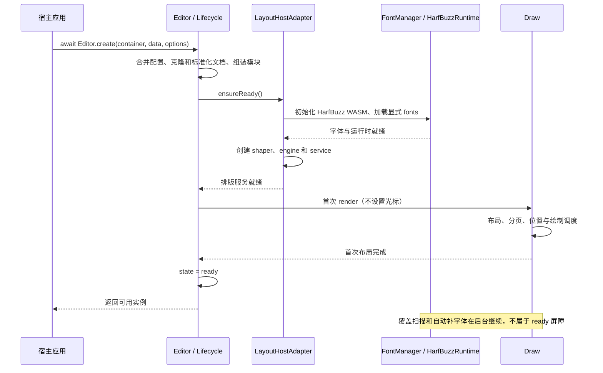
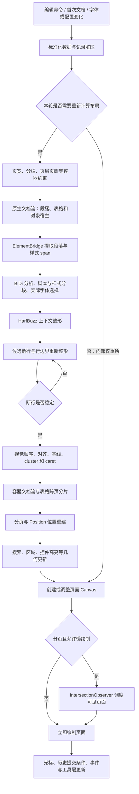
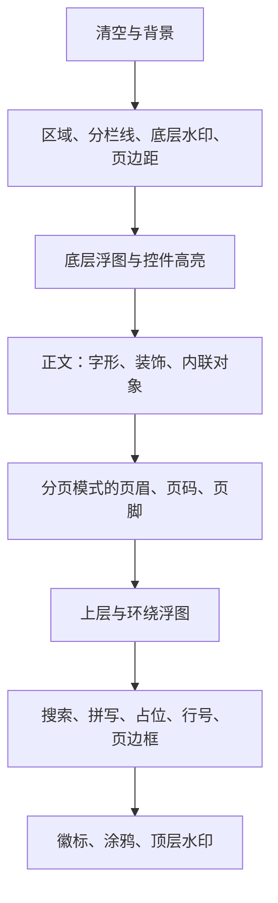
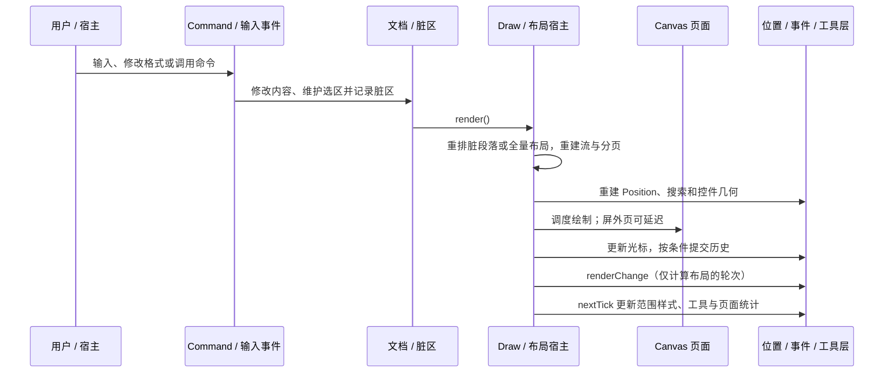
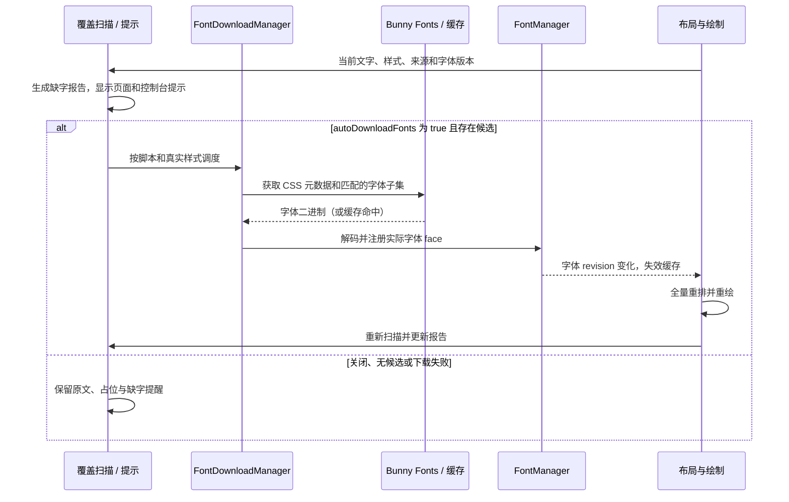

# 渲染管线与时序

本文按当前源码解释从 JSON 到 Canvas，以及编辑、补字体、交互和导出的过程。所有文字走同一套 HarfBuzz 排版与字形轮廓绘制。图中的“原生布局”指本项目的 TextLine/cluster/caret 模型，不是浏览器 DOM 排版，也不是操作系统原生组件。

## 1. 初始化：ready 究竟等待什么



`Editor.create()` 是推荐入口。初始化期间修改/几何命令不排队，调用会失败；少数只读查询和显式异步测高有专门规则，见[字体与初始化迁移](./font-and-esm-migration.md)。同步构造时必须等待 `editor.ready`。

WASM、显式字体初始化或首次布局错误使 ready 拒绝，`initializationError` 保留原因，create 会清理失败实例。缺字本身不会阻止 ready。首次 render 完成也不保证后台字体、图片或所有屏外页面都已绘制完毕：分页模式可以延迟绘制屏外页。

## 2. 从文档到页面的主流程



这里把内部调用展开为概念流程。表格单元格会递归进入段落/对象布局，并非全部文本先独立排完再一次性处理表格。Draw 内部的 `isCompute: false` 只用于已有几何上的重绘；字体、内容或可用宽度变化后不能靠它省略必要布局。宿主应调用公开 command，不应自行调用内部 render。

## 3. 段落如何整形与断行

`ElementBridge` 将文档运行期元素组合为段落和样式 span，同时保留逻辑来源。双向分析确定方向层级，脚本与样式划分形成 run；FontManager 按真实字体 face 的覆盖选择字体。指定 `font` 名称并不意味着系统会为 HarfBuzz 提供对应字体字节。

HarfBuzz 输出 glyph ID、cluster、advance 和 offset。一个字形可能对应多个字符，一个字符也可能参与多个字形；不能用“字符数 × 字宽”代替排版。引擎先整形段落估算断点，再按实际行边界重新整形并细化断行，避免阿拉伯连写或连字在行边界变化后仍使用旧宽度。完成后进行行内视觉重排、对齐与两端对齐。

TextLayoutService 结合真实字体度量和字形墨迹边界生成 ascent、descent、baseline、行内容高度、cluster 与 caret，控件最小宽度和内联对象占位也进入几何。**段前/段后间距独立于字形基线与内容行高处理**，再交给文档流；空段落、连续段落和跨页边界不能靠统一增大文字高度来模拟间距。

| 结果          | 用途                                     |
| ------------- | ---------------------------------------- |
| Glyph         | 字体 face、glyph ID、位置与轮廓绘制      |
| Cluster       | 文字与字形之间的映射、选择范围、删除边界 |
| Caret         | 逻辑位置与视觉位置、方向和键盘移动       |
| TextLine      | 行框、基线、方向、段落间距和对象关联     |
| 页面/容器位置 | 分页、单元格、分栏与最终命中坐标         |

## 4. Canvas 实际如何画文字

GlyphRenderer 从字体 face 取得 glyph 的轮廓命令并缓存，然后以 Canvas 路径填充。正文、页眉页脚、页码、列表标记、占位与辅助文字都不回退到浏览器 `fillText`、`strokeText` 或 `measureText` 文字管线。缺字用显式占位和诊断处理。

原生布局坐标采用缩放前的 CSS 像素。字形相对于行框和基线定位，概念关系如下：

```text
x = line.rect.x + glyph.x + glyph.offsetX
y = line.rect.y + line.baseline + glyph.y + glyph.offsetY
```

字形路径已采用向下为正的 Y 坐标。宿主统一施加缩放和设备像素比，不能在字体、布局、绘制三处重复缩放。文字颜色与装饰取自对应 source/cluster 的样式；图片、公式和对象由专用 painter 负责。

当前单页大致按以下顺序叠加（有条件项仅在相应模式绘制）：



打印模式会省略编辑用的部分区域提示、搜索和高亮等装饰。工具栏、输入代理和外部浮层属于 DOM 层，不能由这张页面叠放图推导其层级。

## 5. 一次编辑的时序



初次 `renderChange` 会延后到 ready 后；普通计算轮次的 renderChange 在后续 nextTick 工具层更新前触发。因此事件不是“所有异步资源和屏外页已完成”的通知。交互命中、选区矩形、箭头移动和删除使用同一份原生行/cluster/caret 几何，避免画面位置与鼠标位置各用一套文字度量。

## 6. 缺字与自动下载的闭环



诊断扫描包含正文、页眉页脚、表格与辅助文字，并按照缺字类别、样式、原因和下载状态输出变化。后台请求会去重，并使用内存/IndexedDB 缓存；缓存命中也需要实际注册后才影响排版。关闭自动下载时不自动请求 Bunny，也不从共享下载缓存自动注册，但显式字体 URL 与手动注册仍允许。

Bunny 的基本字体不是完整 Unicode 保证。罕见字、emoji、地区字形和特殊样式仍可能缺失；网络失败不会切回 legacy 排版。需要固定首次分页、离线或确定性导出时，预先提供所需字体并关闭后台下载。接口与候选范围见[字体迁移指南](./font-and-esm-migration.md)。

## 7. 增量、缓存与失效

`lab.incrementalCompute: true` 复用未变化段落的原生结果。脏段落仍完整整形，因为 BiDi 和上下文连接可能影响全段；缓存的相对索引会映射回当前来源。每轮仍有文档扫描、容器流、分页、表格分片与位置重建，复杂约束保守失效。

| 缓存         | 当前上限或范围  | 失效依据                                        |
| ------------ | --------------- | ----------------------------------------------- |
| 段落布局     | 256 项          | 内容、样式、来源、字体 revision、宽度与逐行约束 |
| 字形轮廓     | 1024 项 / 4 MiB | 字体 face、glyph 与尺寸等键                     |
| 字体覆盖查询 | 2048 项         | 字体与查询键                                    |
| 字体实例     | 256 项          | 实例键与字体生命周期                            |

这些是当前实现细节，不是稳定公开 API。不要据此承诺单次编辑只计算 1–3 行。T23 压力场景中多段落全量/增量约为 348/383 ms，单长段落约为 447/803 ms；测试强制绘制全部页面，不能等同于生产环境可见页输入延迟。完整环境和数据见[最终验收](./native-release-acceptance.md)。

## 8. 图片导出与打印

`command.getImage()` 走 Canvas 页面导出，准备绘制状态与像素比、绘制所有目标页、等待图片观察器后返回 PNG data URL 数组，并恢复临时状态。打印使用临时编辑器等待 ready，再经页面图片和 iframe 交给浏览器打印。

这不是独立 SVG 导出或原生矢量 PDF。HTML/iframe Block、外部图片、字体下载与浏览器打印设置具有额外约束；ready 不能充当“全部资源冻结”的导出屏障。需要稳定输出时，由宿主预置字体、管理图片可用性并对真实业务文档验收。

## 9. 阅读与验证入口

- [架构模块图](./architecture.md)：职责与源码位置。
- [快速上手](./start.md)：初始化、字体、保存和清理。
- [最终验收](./native-release-acceptance.md)：T23/T24、浏览器与性能结论。
- [工程记录](./engineering-records.md)：各阶段设计、历史基线及 SVG 暂缓方案。
